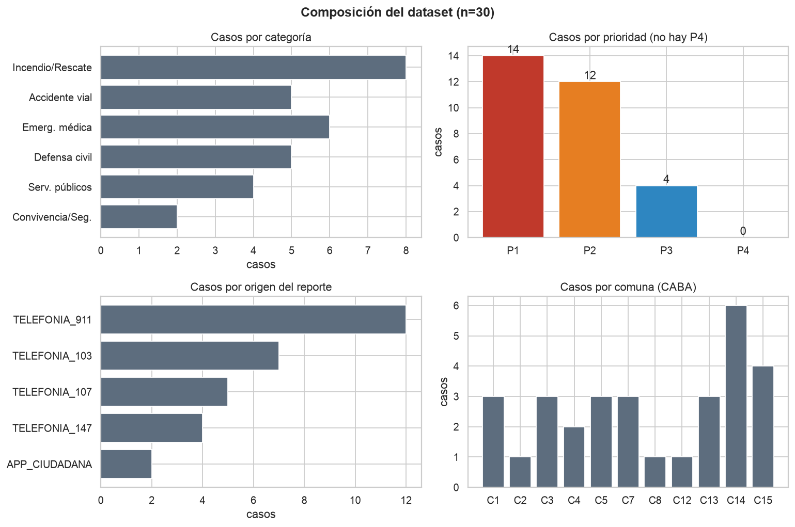
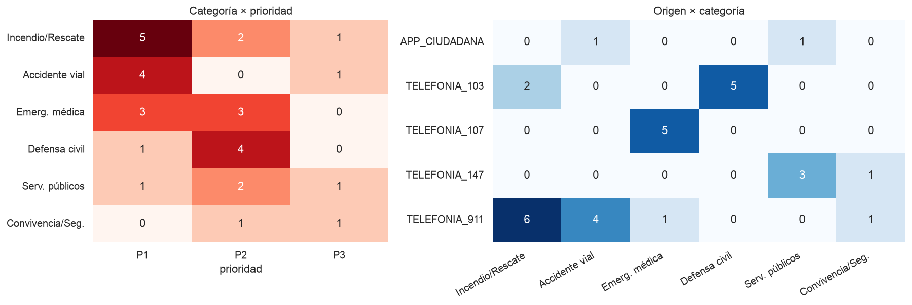
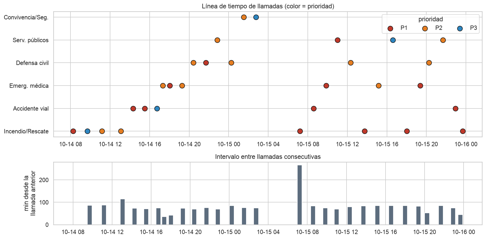
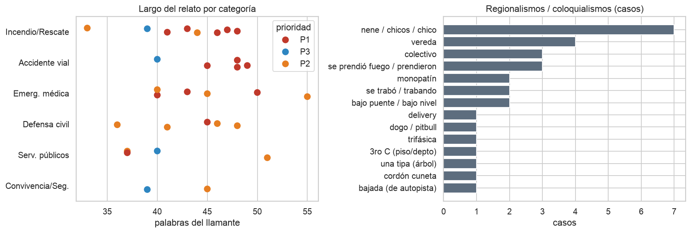
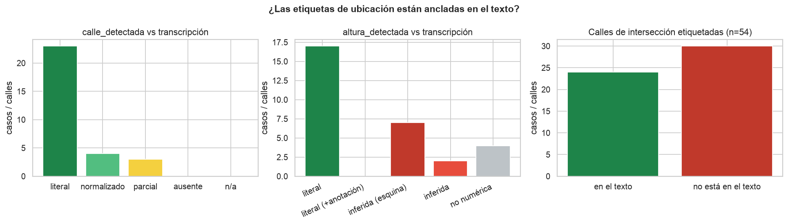
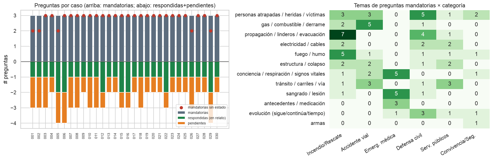
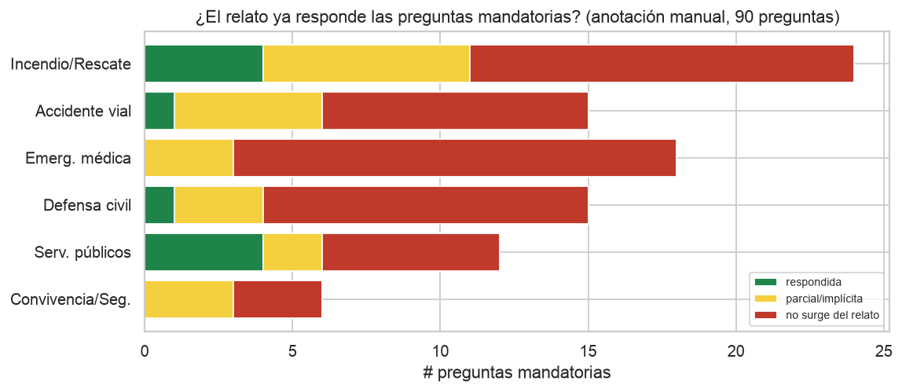
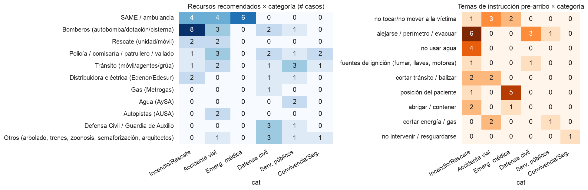

# EDA — dataset del challenge Soflex (Copiloto de Sala)

Dataset: `data/dataset_challenge_soflex.csv`: 30 filas y 18 columnas. Cada fila es una llamada con su transcripción y todos los campos de la "Carta de Llamada" ya completos.
Scripts: `scripts/eda.py` (+ `scripts/common.py`). Las tablas completas que se generan quedan en `scripts/_out/tablas.md`, y los CSV de detalle en `scripts/_out/*.csv`.

> Con n=30 **no hay inferencia estadística posible**. Los números de abajo describen *este* dataset. Sirven para tomar decisiones de diseño, no para afirmar nada sobre la población real de llamadas. Cuando algo es anécdota (1–2 casos), lo digo.

## Resumen ejecutivo

- **Es un catálogo armado a mano, no una muestra operativa.** Las 30 subcategorías son únicas, las 90 preguntas mandatorias son únicas (ninguna se repite literal) y también son únicos todos los textos de instrucciones, riesgos y recursos. No hay nulos. Durante el día 1 las llamadas aparecen **agrupadas por categoría** en el orden del ID. El tiempo no aporta señal.
- **Las transcripciones están "limpias" y son cortas:** siempre 2 turnos (`Operador:` + `Llamante:`), de 38 a 63 palabras. No aparecen `[inaudible]`, repeticiones, cortes ni diálogo de ida y vuelta. Muletillas y lunfardo hay pocos ("mirá", "nene", "colectivo", "se trabó", "está que arde", "a chorros", "mordió el guardarraíl"). El "ruido" de la consigna vamos a tener que **generarlo nosotros** para testear robustez.
- **La calle principal casi siempre está en el texto (30/30 literal, normalizada o parcial).** El resto de la ubicación, no: **30 de las 54 calles de intersección etiquetadas no aparecen en la transcripción** (22/30 casos tienen al menos una) y **9/30 alturas son inferidas** (7 "esquina" con una altura que nadie dijo). La comuna no se menciona nunca. Las etiquetas de ubicación son *ground truth enriquecido con geografía*, no extracción.
- **Las listas del checklist no son coherentes entre sí.** Solo 1 de las 37 "respondidas" y 0 de las 42 "pendientes" coinciden textualmente con una mandatoria. En la mayoría de los casos, respondidas y pendientes son preguntas *distintas* de las mandatorias. Pendientes ≠ mandatorias − respondidas.
- **Anoté a mano las 90 mandatorias contra el relato: 10 respondidas, 23 parciales/implícitas, 57 no surgen.** En la práctica, el checklist arranca casi todo en "pendiente". El valor del copiloto está en decir *qué preguntar ahora*, no en tildar lo ya dicho.
- **Las respuestas del dataset están parafraseadas con jerga clínica** ("cianosis peribucal" por "labios morados", "sialorrea" por "espuma en la boca"). 9/37 tienen menos de 1/3 de sus tokens presentes en el texto. No sirven como evidencia literal; hay que citar el fragmento del relato.
- **La categoría se puede inferir del texto con reglas, pero BM25 sobre 29 vecinos rinde poco:** en leave-one-out, la categoría top-1 acierta 40% (contra 27% de la clase mayoritaria) y la prioridad top-1 acierta 30% (P1 mayoritaria: 47%). Unas reglas de keywords, *escritas mirando el dataset* (o sea, optimistas), llegan a 87% en categoría.
- **No existe P4 y P3 tiene solo 4 casos.** P1 se asocia con señales concretas del relato (exclamaciones 5/14 contra 0 en P2/P3, "no responde/no respira", gas/combustible/eléctrico), pero con n tan chico es orientativo.

---

## 1. Composición

| categoría | n | P1 | P2 | P3 |
|---|--:|--:|--:|--:|
| INCENDIO_RESCATE | 8 | 5 | 2 | 1 |
| EMERGENCIA_MEDICA | 6 | 3 | 3 | 0 |
| ACCIDENTE_VIAL | 5 | 4 | 0 | 1 |
| DEFENSA_CIVIL | 5 | 1 | 4 | 0 |
| SERVICIOS_PUBLICOS | 4 | 1 | 2 | 1 |
| CONVIVENCIA_SEGURIDAD | 2 | 0 | 1 | 1 |
| **total** | 30 | 14 | 12 | 4 |

- **Origen:** TELEFONIA_911 (12), 103 (7), 107 (5), 147 (4), APP_CIUDADANA (2).
- **Geografía:** 17 barrios en 11 comunas, todo CABA. Palermo/C14 tiene 6 casos; el resto, de 1 a 3. Con estos números el cruce categoría×comuna es pura dispersión (ninguna celda pasa de 3) y no conviene leer patrones ahí.
- Subcategoría: 30 valores únicos, uno por caso. **No es una taxonomía**, es una descripción libre.

**Origen × categoría** es lo único con estructura clara, y responde a cómo funciona el sistema real:
107 → siempre EMERGENCIA_MEDICA (5/5); 103 → DEFENSA_CIVIL (5/7) o INCENDIO; 147 → SERVICIOS_PUBLICOS/CONVIVENCIA; 911 → INCENDIO/ACCIDENTE (10/12).
Por prioridad, el 911 concentra P1 (9/12) y el 103 se inclina a P2 (5/7). El origen funciona como **prior** de categoría y prioridad, pero no reemplaza al texto. Por ejemplo, un P1 entra por el 147 (cable con descarga, caso 020) y una emergencia médica por el 911 (caso 010).

## 2. Tiempo

- Rango: **2026-10-14 08:15 → 2026-10-15 23:40** (≈ 39 h). Hay 13 llamadas el día 1 y 17 el día 2.
- El orden del ID coincide 100% con el del timestamp. Los intervalos son casi regulares (mediana 76 min, rango 35–267). El único hueco grande es de ~4,5 h, entre las 02:45 y las 07:12 del día 2.
- **El día 1 está ordenado por categoría:** primero 4 incendios, después 3 accidentes, 3 médicas, defensa civil, servicios y convivencia. El día 2 viene mezclado. Es un artefacto de cómo se armó el dataset.
- Hay saludos que no corresponden a la hora: "buen día" a las 02:45 (caso 016) y a las 16:35 (caso 024). Otro indicio de datos sintéticos.
- **Conclusión:** el tiempo **no tiene señal útil**. No hay estacionalidad, picos ni dependencia de hora o categoría que se pueda defender con n=30. Además, no conviene hacer splits temporales: el split day-1/day-2 metería el sesgo del orden por categoría.

## 3. Transcripciones

| métrica | media | min | max |
|---|--:|--:|--:|
| caracteres | 285 | 242 | 346 |
| palabras (total) | 50 | 38 | 63 |
| palabras del llamante | 44 | 33 | 55 |
| turnos | 2 | 2 | 2 |
| oraciones del llamante | 3,1 | 1 | 5 |

**Estructura.** Siempre son `Operador: <apertura> Llamante: <relato>`. La apertura del operador identifica el servicio ("SAME 107", "103 Guardia de Auxilio", "147 Ciudad") y casi siempre es coherente con `origen_reporte`. Excepciones: dos llamadas del 103 abren con "Emergencias de la Ciudad", y los 2 reportes de APP_CIUDADANA están escritos como diálogo con "Guardia Urbana" / "Monitoreo Urbano". El llamante dice todo en un solo bloque, sin repreguntas. El largo no distingue categorías ni prioridades: todo cae entre 40 y 46 palabras de media.

**Regionalismos y coloquialismos detectados** (casos): "nene/chicos/chico" (7), "vereda" (4), "colectivo" (3), "se prendió fuego / prendieron" (3), "monopatín" (2), "se trabó/trabando" (2), "bajo puente / bajo nivel" (2), y una vez cada uno: "mirá", "delivery", "dogo/pitbull", "trifásica", "3ro C", "una tipa" (árbol), "cordón cuneta", "bajada" de autopista, "mano a Provincia", "canil", "fútbol 5", "bodegón", "mordió el guardarraíl", "a chorros", "blanca como un papel", "está que arde", "picando la vereda", "Belgrano R".

**Ruido / estrés:** "!" en 5 casos (todos P1), pedidos de urgencia ("por favor", "urgente", "Auxilio!", "ya!") en 8, vaguedad del llamante ("monopatín o bicicleta", "como dos metros", "unos 50 años") en 5. **No hay** puntos suspensivos, palabras repetidas, marcas de audio, autocorrecciones ni contradicciones. El dataset no ejercita ruido real de ASR.

**Cómo se dicen las direcciones** (casos que contienen el patrón):

| patrón | casos | ejemplo |
|---|--:|---|
| calle + número directo | 18 | "Av. Corrientes 1540", "Thames 1900" |
| prefijo "Av." | 14 | "Av. Directorio 2140 3ro C" |
| landmark (parque, plaza, estación, rotonda, viaducto, puente, autopista, subestación) | 10 | "Parque Indoamericano", "estación Carlos Pellegrini de la Línea B" |
| "casi X" (esquina cercana) | 6 | "Cabildo 3700, casi Jaramillo" |
| intersección "X y Y" sin número | 6 | "Av. San Juan y Entre Ríos", "Serrano y Honduras" |
| "al NNNN" (altura redondeada) | 4 | "Scalabrini Ortiz al 800" |
| "entre X y Y" | 4 | "entre Vera y Velasco" |
| "altura" | 3 | "a la altura de la bajada de Boedo", "Av. Lugones altura Parque Norte" |
| barrio mencionado | 5 | "en Soldati", "en Balvanera", "en Barracas" |
| piso/depto | 2 | "3ro C", "entre los pisos 5 y 6" |

También aparecen nombres abreviados ("Scalabrini Ortiz", "Lugones", "Salguero"), nombres viejos de calles ("Serrano", hoy J. L. Borges) y ubicaciones sin altura (autopistas, rotondas, subte).

**Señales léxicas por categoría** (aparece en n_cat casos de la categoría / n casos del dataset): INCENDIO → *fuego (4/4), negro (3/3), humo (4/6), olor (3/4)*; ACCIDENTE → *carril (2/3), auto (2/3), pierna (2/2)*; MÉDICA → *dolor, piernas*; SERVICIOS → *agua (2/3)*; CONVIVENCIA → *plaza (2/2)*. El vocabulario casi no se repite entre casos, así que hay pocas palabras que discriminen.

**Señales vs prioridad** (texto del llamante; casos con la señal / total de la prioridad):

| señal | P1 | P2 | P3 |
|---|---|---|---|
| fuego/explosión/humo | 7/14 | 0/12 | 1/4 |
| gas/combustible/eléctrico | 5/14 | 1/12 | 0/4 |
| "!" | 5/14 | 0/12 | 0/4 |
| no respira / no responde / no se mueve | 3/14 | 0/12 | 0/4 |
| personas atrapadas/adentro | 3/14 | 2/12 | 0/4 |
| menores / vulnerables | 2/14 | 2/12 | 1/4 |

## 4. Grounding: ¿las etiquetas salen del texto?

Esta sección es clave para el diseño "evidencia verbatim". Normalicé así: minúsculas, sin acentos, `Av.`→`avenida`, `Gral.`→`general`, sin puntuación. "Parcial" significa que aparece ≥50% de los tokens significativos.

| campo | literal | normalizado | parcial / inferido | ausente / no está |
|---|--:|--:|--:|--:|
| `calle_detectada` (30) | 23 | 4 | 3 parcial | 0 |
| `altura_detectada` (30) | 17 | — | 9 inferidas (7 "esquina") | 4 no numéricas (S/N, Km) |
| calles de `interseccion_detectada` (54) | 24 en el texto | | | **30 no están** |
| barrio (30) | 6 mencionados | | | 24 |
| comuna (30) | 0 | | | 30 |

Ejemplos de enriquecimiento que hace la etiqueta:
- **Nombre completo u oficial:** "Scalabrini Ortiz" → `Av. Raúl Scalabrini Ortiz`; "Lugones" → `Av. Leopoldo Lugones`; "Salguero" → `Jerónimo Salguero`; "Warnes" → `Av. Warnes`.
- **Altura inferida para una esquina:** "Av. San Juan y Entre Ríos" → `1800 (esquina)`; "Escalada y Castañares" → `4500 (esquina)`; "Juan B. Justo y Muñecas" → `4200 (esquina)`.
- **Segunda calle de la intersección agregada:** dicen "casi Montevideo" y la etiqueta es `Montevideo y Paraná`; dicen "Yerbal 2450" y la etiqueta es `Artigas y Fray Cayetano Rodríguez` (ninguna de las dos se dijo).
- **Formatos no numéricos de altura:** `Km 4.5 (altura Boedo)`, `Km 7 (altura Parque Norte)`, `S/N (Estación Subterránea)`, `S/N (Rotonda Puente Alsina)`, `3400 (bajo viaducto)`.
- **Inconsistencia interna:** en el caso 015, `calle_detectada = Serrano` e intersección `Honduras y Jorge Luis Borges`. Serrano y J. L. Borges son **la misma calle** (se renombró).
- En el caso 007 el llamante dice "Belgrano R" y la etiqueta es `Colegiales`. El barrio sale de la geografía, no del relato.

**Respuestas de `preguntas_respondidas_en_relato`:** sobre 37 respuestas, en promedio el 64% de sus tokens están en la transcripción; 19 son casi literales, 9 medias y 9 bajas. Las bajas son traducciones clínicas o resúmenes:

| caso | respuesta del dataset | lo que dijo el llamante |
|---|---|---|
| 019 | "Edema facial, disnea aguda, disfagia, urticaria generalizada" | "cara totalmente hinchada… no puede tragar… ronchas" |
| 026 | "Crisis tónico-clónica generalizada, sialorrea…" | "convulsionando… espuma en la boca" |
| 009 | "tiraje intercostal y cianosis peribucal" | "tiraje en las costillas y los labios morados" |
| 022 | "No al momento" (¿fuego?) | "No hay fuego por ahora" |

→ El dataset **no** sirve como gold de "evidencia literal" para las respuestas. La evidencia tiene que ser el fragmento del relato, y la respuesta normalizada va aparte.

## 5. Preguntas de protocolo

- **Siempre hay 3 mandatorias por caso.** Respondidas: 1–2 (media 1,23). Pendientes: 1–2 (media 1,4).
- **90/90 mandatorias son únicas.** La similitud de tokens entre mandatorias de la *misma* categoría (media Jaccard 0,013) es prácticamente igual a la que hay *entre* categorías (0,008). El dataset no trae un checklist por categoría: trae preguntas ad hoc por subcategoría.
- **Consistencia entre listas:**

| chequeo | valor |
|---|--:|
| respondidas con texto idéntico a una mandatoria | 1 / 37 |
| pendientes con texto idéntico a una mandatoria | 0 / 42 |
| respondidas con match difuso (Jaccard ≥ 0,25) a una mandatoria | 4 / 37 |
| pendientes con match difuso a una mandatoria | 1 / 42 |
| casos donde respondidas ∪ pendientes cubre las 3 mandatorias | 0 / 30 |

  Ejemplo, caso 001. Mandatorias: {atrapados, garrafas/gas, linderos}. Respondidas: {atrapados} ✓. Pendientes: {¿cortó la llave de gas?, ¿humo en pisos superiores?}. "Garrafas" y "linderos" no quedan en ninguna de las dos listas, y las pendientes son preguntas nuevas.
  Hay solapamientos semánticos que el texto no explicita. En el caso 011, la pendiente "¿Los autos estaban desocupados?" es la mandatoria "¿Había ocupantes dentro de los rodados?" dicha de otra forma.
- **Formato:** dos mandatorias traen la instrucción adentro de la pregunta: "¿Se le retiró el casco? **(NO retirar)**" y "¿Se le colocó algún objeto en la boca? **(NO colocar)**".

**Anotación manual** (mía, subjetiva): ¿el relato ya contesta cada mandatoria?

| estado | preguntas |
|---|--:|
| respondida (A) | 10 (11%) |
| parcial / implícita (P) | 23 (26%) |
| no surge del relato (N) | 57 (63%) |

EMERGENCIA_MEDICA tiene 0 respondidas sobre 18: las preguntas clínicas (antecedentes, EpiPen, tiempo de crisis) nunca aparecen en el relato espontáneo. El detalle está en `data/eval/mandatorias_anotacion_manual.csv` (el gold de la evaluación).

**Temas recurrentes por categoría → catálogo canónico propuesto.** Lo armé agrupando las 90 mandatorias por intención y completándolas con las pendientes:

| categoría | checklist canónico propuesto (orden = criticidad) |
|---|---|
| INCENDIO_RESCATE | ¿Hay personas atrapadas/adentro? · ¿Todos evacuaron? · ¿Hay gas (garrafa/cañería) o materiales peligrosos (baterías, aceite, químicos)? · ¿Fuego/humo se propaga a linderos o pisos superiores? · ¿Hay riesgo eléctrico (tablero, cables)? · ¿Hay heridos/quemados? |
| ACCIDENTE_VIAL | ¿Las víctimas respiran y responden? · ¿Hay atrapados en vehículos? · ¿Cuántos vehículos/víctimas? · ¿Derrame de combustible/humo? · ¿Carriles bloqueados / riesgo de 2.º impacto? · (moto) ¿tiene casco? → NO retirar |
| EMERGENCIA_MEDICA | ¿Está consciente y puede hablar? · ¿Respira con normalidad? · ¿Sangrado (tipo, cantidad)? · ¿Golpe en la cabeza / caída? · ¿Antecedentes / medicación (anticoagulantes, EpiPen, inhalador)? · ¿Desde cuándo / evoluciona? · Edad aproximada |
| DEFENSA_CIVIL | ¿Hay personas atrapadas, aisladas o heridas? · ¿Cables caídos o riesgo eléctrico? · ¿Hay gas? · ¿La situación sigue empeorando (agua sube, estructura cede, fuga)? · ¿Se evacuó/aisló la zona? |
| SERVICIOS_PUBLICOS | ¿Hay heridos o vehículos/personas afectados? · ¿Riesgo eléctrico (cables, agua sobre tableros)? · ¿Se agranda o empeora? · ¿Afecta tránsito / transporte? · ¿Hay agentes en el lugar? |
| CONVIVENCIA_SEGURIDAD | ¿Hay armas (blancas/fuego)? · ¿Hay heridos o inconscientes? · ¿Los involucrados siguen en el lugar? · ¿Hacia dónde se dispersan? · (animal) ¿mordidos?, ¿está contenido? |

## 6. Instrucciones pre-arribo, riesgos y recursos

- **Instrucciones:** de 1 a 4 oraciones (media 2,2) y de 14 a 41 palabras. Usan imperativo, casi siempre con una prohibición ("No…", "Prohibido…", "NUNCA…"; media 1,1 por caso). Dos usan MAYÚSCULAS de énfasis ("BAJO NINGUNA CIRCUNSTANCIA retire el casco", "NO ARROJAR AGUA COMÚN"). Las 30 son únicas y la similitud léxica es baja incluso dentro de una misma categoría (Jaccard medio 0,04). Lo que sí se repite son los **temas**: alejarse/perímetro (10), "no usar agua" (4, todos de incendio: eléctrico, litio, aceite, contenido desconocido), posición del paciente (6), no mover a la víctima (6), cortar tránsito (4), fuentes de ignición (2).
- **Las instrucciones dependen de la subcategoría, no solo de la categoría:** "no arrojar agua" vale para fuego eléctrico o de litio y estaría mal en un pastizal. La posición del paciente cambia por cuadro (Trendelenburg para el síncope, sentado para el asma y la anafilaxia, lateral después de una convulsión).
- **Riesgos:** de 1 a 3 frases por caso (media 2,3), texto libre, ninguno repetido literalmente.
- **Recursos:** formato `"1x Unidad … + 1x …"` (48/63 ítems traen `Nx`; el resto, cosas como "Vallado policial" o "Alerta a Metrogas"). El vocabulario se agrupa bien en ~11 familias: SAME (14 casos), Bomberos (14), Policía (9), Tránsito (8), Rescate (4), Edenor/Edesur (4), Defensa Civil/Guardia de Auxilio (4), AySA (2), AUSA (2), Metrogas (1), otros (arbolado, trenes, zoonosis, semaforización). SAME aparece en 10/14 P1 y en 0/4 P3. El número de ítems casi no cambia con la prioridad (2,2 / 1,9 / 2,3).
- Los nombres propios de jurisdicción ("Comisaría Vecinal 15B", "14A") **no surgen del relato**: se infieren de la comuna.

## 7. Calidad de datos y huecos

| tema | hallazgo |
|---|---|
| Nulos | 0 en las 18 columnas |
| Clases | no hay P4; P3 = 4; CONVIVENCIA_SEGURIDAD = 2; APP_CIUDADANA = 2 |
| Unicidad | subcategoría, mandatorias, instrucciones, riesgos y recursos son 100% únicos → no hay catálogo implícito |
| Formatos de altura | número, `N (esquina)`, `N (bajo viaducto)`, `S/N (…)`, `Km X (altura …)` → mezclan valor y anotación |
| Intersección | separador `" y "` o `" / "`; a veces 1 calle, a veces 2; a veces incluye la calle principal (caso 008) |
| Checklist | respondidas/pendientes con wording distinto de las mandatorias; pendientes ≠ mandatorias − respondidas |
| Respuestas | parafraseo clínico, no literal |
| Inconsistencias | Serrano = J. L. Borges (015); "buen día" a las 02:45 y 16:35; 103 abriendo como "Emergencias de la Ciudad"; caso 021 habla de "vías de Figueroa Alcorta" (dudoso geográficamente) |
| Orden | día 1 ordenado por categoría |
| Transcripciones | sin ruido de ASR, sin diálogo multi-turno, sin datos faltantes (todos los casos traen alguna ubicación) |

No validé la geografía (si cada altura y barrio son reales) contra una fuente oficial. Algunos casos parecen plausibles y otros dudosos, así que **no hay que usar estas etiquetas como gazetteer**.

## 8. Baseline: ¿qué tan predecible es la categoría o prioridad desde el texto?

BM25 implementado a mano, sobre los tokens del llamante, en leave-one-out (29 vecinos):

| tarea | top-1 | voto top-3 | baseline mayoritaria |
|---|--:|--:|--:|
| categoría | 0,40 | 0,40 | 0,27 |
| prioridad | 0,30 | 0,47 | 0,47 (todo P1) |

Los errores tienen sentido: las inundaciones y los anegamientos se confunden entre ACCIDENTE, DEFENSA_CIVIL y SERVICIOS (021↔006, 012↔028); el asma y el síncope caen en INCENDIO por "aire" o "humo". Las fronteras DEFENSA_CIVIL / SERVICIOS_PUBLICOS / INCENDIO_RESCATE son **difusas por definición**: un caño de gas roto es DEFENSA_CIVIL, un caño de agua roto es SERVICIOS y un derrame de gasoil es INCENDIO. Las reglas de keywords llegan a 0,87 en categoría, pero las escribí mirando estos mismos 30 casos, así que es sobreajuste y no una estimación.

---

## Implicancias para el diseño

**Ubicación (extracción):**
1. Usar regex por capas, en este orden: `(Av\.|Avenida)?\s*<Calle>\s+(al\s+)?\d{2,5}` → `entre X y Y` → `casi X` / `esquina (de)? X y Y` / `X y Y` → `altura|a la altura de <landmark>` → piso/depto `\d+(ro|do|to|°)\s*[A-Z]` → landmarks (`Parque|Plaza|estación|Línea [A-H]|Autopista|AU\s?\d|bajada|rotonda|viaducto|puente|subestación`). Normalizar antes: acentos, `Av.`, `Gral.`, `Juan B.`.
2. **Separar "dicho" de "inferido" en la Carta.** `calle` y `altura` sí se pueden extraer con evidencia. `intersección` (56% de las calles), `barrio` (80% de los casos) y `comuna` (100%) **no** están en el texto: el LLM no los puede afirmar con cita. Hay que mostrarlos como "a confirmar/geocodificar" (o vacíos), nunca como hechos. Si se completan, que sea con un gazetteer o geocoder explícito y marcado como tal.
3. Hace falta un **alias de calles** chico: Serrano→J. L. Borges, Scalabrini Ortiz→Av. Raúl Scalabrini Ortiz, Lugones→Av. Leopoldo Lugones, Salguero→Jerónimo Salguero, Juan B. Justo, etc. Con eso el verificador acepta la evidencia "Scalabrini Ortiz" para el campo canónico.
4. Modelar la altura como `{numero?: int, tipo: exacta|redondeada("al")|esquina|km|s/n, referencia?: str}` y no como string libre. "al 800" ≠ "800".

**Categoría / prioridad:**
5. Para el mock: reglas de keywords con pesos más el origen de la llamada como prior (107→médica, 103→defensa civil, 147→servicios). BM25 va como "casos similares" para mostrarle al operador, **no** como clasificador.
6. La prioridad tiene que salir de **disparadores explícitos y auditables** (no respira/no responde, atrapados, fuego/explosión activa, gas/combustible/eléctrico, menores/vulnerables, cantidad de víctimas) que suban el nivel, con la cita del disparador. Si no se dispara nada, queda en P2/P3 según la categoría. Con 14/12/4 no hay datos para aprender umbrales.
7. **P4**: el dataset no lo define. Propuesta: P4 = reclamo sin riesgo para personas ni bienes y sin urgencia (típicamente 147: luminaria, poda, ruidos, bache sin riesgo), definido por regla y documentado como supuesto. Nunca hay que bajar a P4 si aparece algún disparador de P1/P2.

**Checklist dinámico:**
8. Como el dataset no trae checklist por categoría (90/90 preguntas únicas), hay que **curar el catálogo canónico** (tabla de la §5), con preguntas compartidas por categoría y un par de preguntas por subtipo (casco en moto, litio, ascensor). El estado de cada pregunta lo decide un matcher de evidencia: el LLM propone "respondida + cita" y el verificador comprueba que la cita esté en el texto. Si no hay cita, queda pendiente.
9. Lo esperable es que ~60% del checklist arranque pendiente. La UI tiene que priorizar **"próxima pregunta a hacer"** ordenada por criticidad, no un tablero de checks.
10. No usar `preguntas_respondidas/pendientes` del CSV como gold automático: su redacción no coincide con las mandatorias. Para evaluar, usar mi anotación manual de las 90 mandatorias (`data/eval/mandatorias_anotacion_manual.csv`, idealmente revisada por una segunda persona).

**Instrucciones pre-arribo:**
11. Catálogo por categoría **y subtipo**, con contraindicaciones explícitas como reglas: "no agua" solo para eléctrico, litio o aceite; "no retirar casco" solo para moto; la posición del paciente según el cuadro. Las 30 instrucciones del CSV sirven de semilla, pero están escritas para cada caso. Para un operador bajo estrés: 1–3 frases cortas en imperativo, con la prohibición crítica primero.

**Campos donde no confiar en el LLM:** intersección, barrio, comuna, unidad o comisaría de jurisdicción, recursos específicos (empresa distribuidora, AUSA, etc.), instrucciones y preguntas del protocolo. Todo eso sale de catálogos o geocoder, o se deja vacío. Del LLM se aceptan solo spans con evidencia: calle, altura, señales de riesgo y respuestas del checklist.

**Evaluación:**
12. Con n=30, usar **leave-one-out** para todo lo que use vecinos (BM25). Reportar exact-match por campo (calle normalizada, altura numérica, categoría, prioridad) y **tasa de alucinación** (campos afirmados sin evidencia verificable). Para el checklist, precisión y recall contra la anotación manual. No reportar intervalos ni significancia sin aclarar que n=30 no da para eso.
13. **Generar variantes ruidosas** de los 30 relatos para probar robustez, porque el dataset no las trae: muletillas ("eh, este…"), repeticiones, autocorrecciones ("en Corrientes… no, perdón, en Montevideo"), números en palabras ("mil quinientos cuarenta"), sin "Av.", typos de ASR, diálogo multi-turno y relatos sin dirección. Medir la degradación contra el original.
14. No hacer split temporal (día 1 viene ordenado por categoría) ni estratificar por comuna (dispersión total).
